# Tayaqan Architecture Plan

**TAYAQAN — A Unified Blockchain-Based System for Certificate Management and Verification**

| | |
|---|---|
| **Document type** | Software Architecture Description |
| **Course** | CPIT 499 — Senior Project |
| **Institution** | Department of Information Technology, Faculty of Computing and Information Technology, King Abdulaziz University, Jeddah |
| **Team** | Rawan Alshehri · Fatimah Alessa · Njood Aljagthmi · Sara Sultan Alharbi |
| **Supervisor** | Dr. Suhair Alshehri |
| **Related documents** | [API-Routes.md](API-Routes.md) · [System-Roles.md](System-Roles.md) · [Contract-Functions.md](Contract-Functions.md) · [UI-Flow.md](UI-Flow.md) · CPIT 499 Final Report |

---

## Table of Contents

1. [Introduction](#1-introduction)
2. [Architectural Drivers](#2-architectural-drivers)
3. [System Context](#3-system-context)
4. [Container Architecture](#4-container-architecture)
5. [Component Design](#5-component-design)
6. [Data Architecture](#6-data-architecture)
7. [Key Workflows](#7-key-workflows)
8. [Security Architecture](#8-security-architecture)
9. [Deployment Architecture](#9-deployment-architecture)
10. [Configuration](#10-configuration)
11. [Quality Evidence](#11-quality-evidence)
12. [Architectural Decisions](#12-architectural-decisions)
13. [Known Limitations and Future Work](#13-known-limitations-and-future-work)
14. [Glossary](#14-glossary)

---

## 1. Introduction

### 1.1 Purpose

This document describes the software architecture of Tayaqan: how the system is structured, how its parts communicate, where data lives, and why the key design decisions were made. It is intended for developers, reviewers, and the project evaluation committee.

Figures labelled *Report Fig. N* come from the CPIT 499 Final Report and show the design view. Where the implementation differs from the design, the text says so. Diagrams drawn in Mermaid reflect the current source code.

### 1.2 Problem Statement

Certificate verification in Saudi Arabia is still largely manual. Employers contact each issuing institution individually or rely on third-party services, which takes from a few days to over a week. There is no unified system that connects institutions, applicants, and employers, and applicants have little control over who sees their credentials.

### 1.3 Solution Overview

Tayaqan connects all three parties on one platform:

- **Institutions** issue certificates whose SHA-256 fingerprint is recorded on an Ethereum smart contract owned by that institution.
- **Applicants** hold all their certificates in one place and decide which employers may see which certificates, and for how long.
- **Employers** request access and receive results that are verified against the blockchain at the moment they are viewed.

Certificate files are stored on **Storacha** (IPFS-based decentralized storage). The blockchain stores only hashes and access rules, never the documents themselves or personal data in plain form.

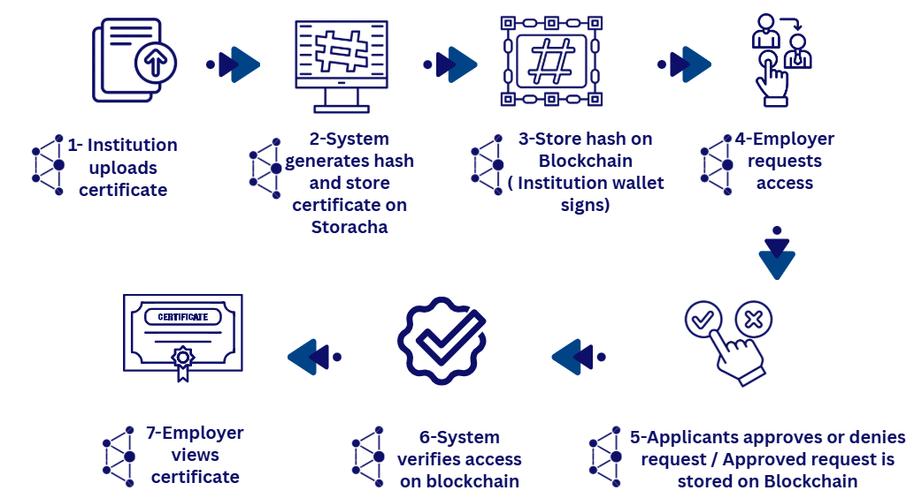

*Report Fig. 1 — End-to-end workflow: upload → hash and store → record on chain → access request → applicant approval → on-chain access check → employer views certificate.*

### 1.4 Development Methodology

The project followed the **Waterfall** model (requirements → design → implementation and unit testing → integration and system testing → operation). The requirements were stable from the start and the blockchain components needed careful up-front design, which suited a sequential process with full documentation at each stage.

---

## 2. Architectural Drivers

### 2.1 Functional Requirements and Where They Are Realized

| Code | Requirement | Realized by |
|---|---|---|
| FR1 | Users (institutions, applicants, employers) can sign up | `accounts` · `POST /api/accounts/signup/{applicant\|employer\|institution}/` |
| FR2 | Users can log in | `accounts` · `POST /api/accounts/auth/login/` (JWT; email or national ID) |
| FR3 | Institutions add certificates | `certificates` · `institution/prepare` → MetaMask `issueCertificate` → `institution/confirm` |
| FR4 | Employers request access to an applicant's certificates | `access` · `POST /api/access/employer/requests/` |
| FR5 | Applicants approve or reject access requests | `access` · `my/requests/{id}/approve` / `reject` → `addEmployerAccess` on chain |
| FR6 | Applicants view their verified certificates | `certificates` · `GET /api/certificates/my/` + `my/verify-batch` |
| FR7 | Employers view verification results after approval | `access` · `employer/certificates/{id}` → `checkEmployerAccess` on chain |
| FR8 | Institutions revoke certificates | MetaMask `revokeCertificate` → `institution/{id}/revoke` |
| FR9 | Admin approves or rejects institutions and employers | `accounts` · `admin/accounts/{id}/status` → auto-deploys `CertificateRegistry` |

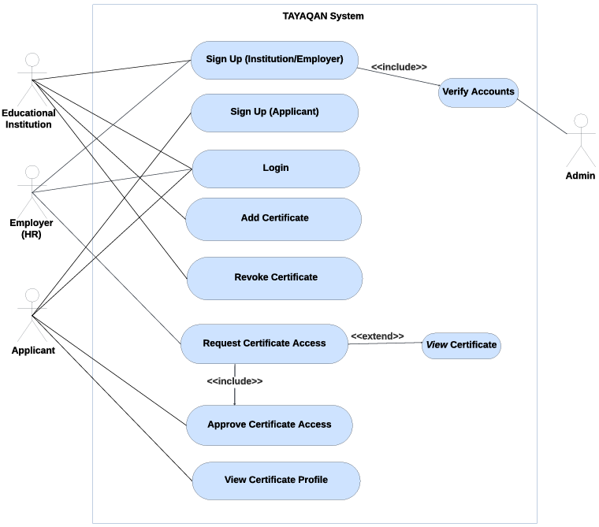

*Report Fig. 4 — Use case diagram.*

### 2.2 Quality Attributes

| Code | Attribute | Architectural response |
|---|---|---|
| NFR1 | **Security and integrity**: data is stored and transmitted securely | Hash-anchored certificates, per-institution contracts, `onlyInstitution` / `onlyAdmin` modifiers, JWT, role and ownership checks (§8) |
| NFR2 | **Scalability**: more users and certificates without degradation | Mapping-based O(1) certificate lookup, one contract per institution, free read-only verification, constant gas per issuance (§11.3) |
| NFR3 | **Usability**: intuitive interface for all roles | Only institutions need a wallet; applicants and employers use a normal web app (§12, AD-4); usability score 4.78/5 (§11.4) |
| — | **Privacy and applicant control** | Only Keccak-256 hashes of identifiers on chain; employers see only certificates the applicant selected, for a limited time |
| — | **Auditability** | On-chain events for issue, revoke, grant, and remove; transaction hashes and block numbers stored in the database |

### 2.3 Constraints

- Graduation project; the default environment is a single developer machine.
- Targets EVM-compatible networks: a local Hardhat node for development and Ethereum Sepolia for public testing.
- On-chain writes cost gas, so on-chain data is kept to the minimum needed for verification.
- Storacha uploads use a Node.js client, so the backend host needs Node.js as well as Python.

---

## 3. System Context

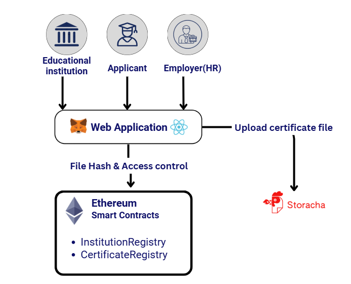

*Report Fig. 2 — High-level architecture: three user roles use the web application; files go to Storacha; hashes and access rules go to the Ethereum smart contracts.*

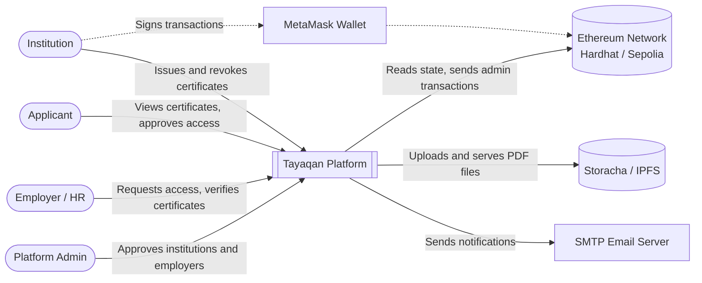

| Actor / System | Role |
|---|---|
| **Institution** | Universities and training providers that issue certificates. Must be approved by an admin and own an Ethereum wallet. |
| **Applicant** | Graduates who receive certificates and control sharing. Identified by national ID. |
| **Employer** | Organizations that verify applicants' credentials. Must be approved by an admin. |
| **Platform Admin** | Operates the platform, reviews registration proof documents, and owns the admin wallet. |
| **Ethereum network** | Stores certificate hashes, revocation state, and employer access rules. |
| **Storacha** | Stores the certificate PDF files, addressed by content identifier (CID). |
| **SMTP server** | Delivers transactional emails (approvals, new certificates, access requests). |

---

## 4. Container Architecture

The system is made of five runtime units.

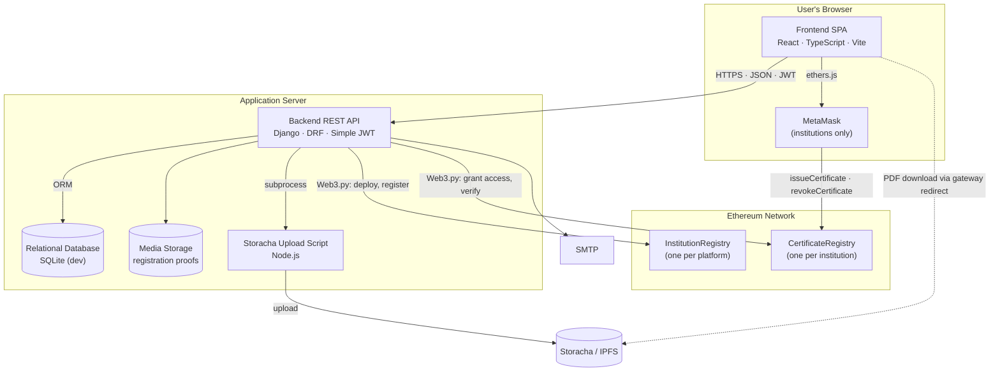

| Container | Technology | Responsibility |
|---|---|---|
| **Frontend SPA** | React, TypeScript, Vite, React Router, TanStack Query, React Hook Form, Zod, i18next, Tailwind CSS, ethers.js 6 | Role-based user interface, form validation, JWT session handling, and MetaMask transaction signing for institutions |
| **Backend REST API** | Python, Django, Django REST Framework, Simple JWT, drf-spectacular, django-filter, django-cors-headers, Web3.py | Authentication, authorization, business rules, persistence, blockchain orchestration, file upload, and email |
| **Database** | SQLite (development) | Users, profiles, certificate metadata, access requests and shares, and blockchain transaction references |
| **Smart contracts** | Solidity (`pragma ^0.8.19`, compiled with 0.8.28), Hardhat, hardhat-deploy | Immutable record of certificate hashes, revocation state, and employer access grants |
| **Decentralized storage** | Storacha (`@storacha/client`) | Content-addressed storage of certificate PDFs |

**Why a hybrid storage model?** Ethereum gives immutability but is expensive per byte; Storacha gives cheap, content-addressed file storage; the relational database gives fast queries and user-facing metadata. Each kind of data is stored where it fits best (§6.1).

---

## 5. Component Design

### 5.1 Repository Structure

```text
Tayaqan-Certificate-Verification-System/
├── frontend/                    # React single-page application
│   └── src/
│       ├── App.tsx              # Route table and role guards
│       ├── App/layout/          # Navbar, Footer, PublicLayout, navigation config
│       ├── Pages/
│       │   ├── auth/            # Login, role-specific signup, password reset
│       │   ├── InstitutionRole/ # Upload, issued list, details, revoke
│       │   ├── ApplicantRole/   # My certificates, incoming access requests
│       │   └── EmployerRole/    # Create request, shared certificates, details
│       ├── components/          # Reusable UI components
│       └── lib/                 # API client, auth, token storage, types
│
├── backend/                     # Django project
│   ├── core/                    # Settings, root URL configuration, WSGI/ASGI
│   ├── api/
│   │   ├── accounts/            # Users, roles, signup, admin moderation
│   │   ├── certificates/        # Issuance, listing, download, revocation
│   │   └── access/              # Employer requests and applicant sharing
│   └── helpers/                 # Web3 client, contract loaders, Storacha script
│
├── Contract/                    # Hardhat project
│   ├── contracts/               # InstitutionRegistry.sol, CertificateRegistry.sol
│   ├── deploy/                  # hardhat-deploy scripts
│   ├── test/                    # Unit, integration, and performance tests
│   └── reports/                 # Gas, latency, cost, and scalability charts
│
└── Docs/                        # Project documentation (this file, figures in Docs/images/)
```

### 5.2 Class Model

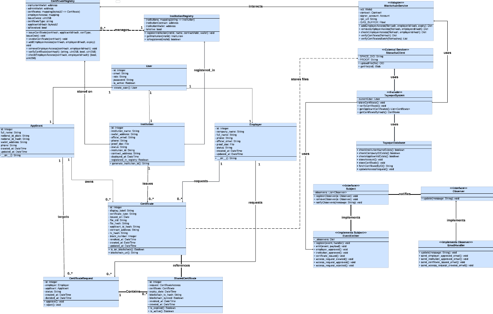

*Report Fig. 5 — Class diagram.*

The class diagram combines the domain model (User, Applicant, Institution, Employer, Certificate, CertificateRequest, SharedCertificate), the two smart contracts, and the integration and notification classes. Mapping to the code:

| Design class | Implementation |
|---|---|
| `User`, `Applicant`, `Institution`, `Employer` | `backend/api/accounts/models.py` |
| `Certificate` | `backend/api/certificates/models.py` |
| `CertificateRequest`, `SharedCertificate` | `AccessRequest`, `AccessShare` in `backend/api/access/models.py` |
| `BlockchainService` (Adapter) | `backend/helpers/blockchain_service.py` |
| `StorachaClient` | `backend/helpers/storacha_upload.js`, called from `certificates/views.py` |
| `TayaqanSystem` (Facade) | Logical role, filled by the DRF ViewSets in each app |
| `TayaqanDatabase` | Django ORM |
| `Subject` / `EventEmitter` / `EmailHandler` (Observer) | `events.py` and `handlers.py` in each app |

### 5.3 Design Patterns

| Pattern | Where | Benefit |
|---|---|---|
| **Facade** | The API ViewSets present one simple interface (`prepare`, `confirm`, `approve`, …) over storage, hashing, blockchain, and database work | The frontend never deals with Web3 or Storacha details, except for the institution's MetaMask signature |
| **Adapter** | `BlockchainService` wraps Web3.py and the contract ABI behind Python methods (`add_employer_access`, `verify_certificate`, …) with gas estimation and error normalization | Views stay free of blockchain plumbing; the network can change without touching business logic |
| **Observer** | `events.py` (subject) and `handlers.py` (observers) per app, registered in `AppConfig.ready()` | Approval, issuance, and access events trigger emails and contract deployment without coupling views to side effects |
| **Registry** | `InstitutionRegistry` maps institution IDs to their `CertificateRegistry` contracts | One global directory on chain; per-institution isolation |
| **Two-phase commit** | Issuance: `prepare` → on-chain transaction → `confirm` | The database record is created only after the blockchain transaction succeeds |

### 5.4 Frontend

The frontend is a single-page application organized **by user role**.

| Layer | Location | Description |
|---|---|---|
| **Routing** | `src/App.tsx` | Declares public, auth, and role-specific routes, wrapped by `ProtectedRoute` (requires a session) and `RoleRoute` (requires a matching role) |
| **Layout** | `src/App/layout/` | Shared navigation and footer; `nav.config.ts` drives role-specific menu items |
| **Pages** | `src/Pages/<Role>/` | One folder per role; each page owns its data fetching and forms |
| **API client** | `src/lib/api.ts` | Wraps `fetch`, attaches the bearer token, refreshes an expired access token once, and normalizes errors |
| **Session** | `src/lib/auth.ts`, `storage.ts`, `profile.ts` | Stores tokens and the user profile; login and logout helpers |
| **Wallet** | `uploadCertificate.tsx`, `IssuedCertificates.tsx` | `ethers.BrowserProvider(window.ethereum)` signs `issueCertificate` and `revokeCertificate`; detects a wallet that does not match the institution's registered address and blocks submission |

| Area | Routes |
|---|---|
| Public | `/`, `/about`, `/how-it-works`, `/login`, `/signup`, `/signup/{applicant\|employer\|institution}`, `/forgot-password`, `/reset-password` |
| Institution | `/institution`, `/institution/upload`, `/institution/success`, `/institution/certificates`, `/institution/certificates/:id` |
| Applicant | `/applicant`, `/applicant/certificates`, `/applicant/certificates/:id`, `/applicant/requests`, `/applicant/requests/:requestId` |
| Employer | `/employer`, `/employer/access`, `/employer/access/new`, `/employer/access/:requestId/certificates`, `/employer/certificates/:id` |

> Client-side route guards improve the user experience only. The backend enforces all authorization again.

### 5.5 Backend

The backend has one Django app per business domain.

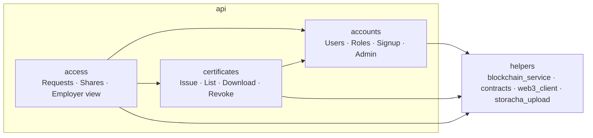

Each app is layered the same way:

| Layer | File | Responsibility |
|---|---|---|
| Routing | `urls.py` | DRF `DefaultRouter` registrations |
| Presentation | `views.py` | ViewSets and custom `@action` endpoints |
| Validation / mapping | `serializers.py`, `validators.py` | Input validation and output shaping |
| Authorization | `permissions.py` | Role and approval-status checks |
| Domain model | `models.py` | Entities, constraints, domain methods (`approve()`, `is_active()`) |
| Domain events | `events.py` | In-process observer registry |
| Side effects | `handlers.py` | Email delivery and blockchain deployment triggered by events |

| App | Base path | Key endpoints |
|---|---|---|
| `accounts` | `/api/accounts/` | `auth/login`, `auth/refresh`, `auth/me`, `signup/{applicant,employer,institution}`, `admin/accounts/pending`, `admin/accounts/{id}/status`, `password/request`, `password/confirm`, `applicants/verify/{national_id}` |
| `certificates` | `/api/certificates/` | `institution/` (list, retrieve), `institution/prepare`, `institution/confirm`, `institution/{id}/file`, `institution/{id}/revoke`, `institution/verify-batch`, `my/` (list, retrieve), `my/{id}/file`, `my/verify-batch` |
| `access` | `/api/access/` | `employer/requests/` (create, list), `employer/requests/{id}/shared`, `employer/certificates/{id}`, `employer/certificates/{id}/file`, `my/requests/` (list), `my/requests/{id}/approve`, `reject`, `candidate_certificates`, `shared_certificates`, `revoke_access` |
| API docs | `/api/` | `schema/` (OpenAPI 3), `docs/` (Swagger UI), `redoc/` |

**Integration helpers**

| Module | Responsibility |
|---|---|
| `helpers/web3_client.py` | Shared `Web3` connection; loads the admin account and `InstitutionRegistry` address from the environment |
| `helpers/contracts.py` | Loads ABIs and bytecode from Hardhat artifacts and deployment files; checks all contracts are available at startup |
| `helpers/blockchain_service.py` | `BlockchainService` adapter: gas estimation with a 20% buffer and fallback limits, EIP-1559-aware gas pricing, signing, and read calls |
| `helpers/storacha_upload.js` | Authenticates to a Storacha space with a delegated proof, uploads a PDF, and prints the CID as JSON |

**Domain events**

| Event | Emitted by | Handlers |
|---|---|---|
| `institution_approved` | Admin status update | Generate institution ID, deploy `CertificateRegistry`, register it in `InstitutionRegistry`, send approval email |
| `employer_approved` | Admin status update | Send approval email |
| `certificate_issued` | `certificates/institution/confirm` | Email the applicant |
| `access_request_created` | Employer creates a request | Email the applicant |
| `access_request_approved` / `rejected` | Applicant decision | Email the employer |

### 5.6 Smart Contracts

The on-chain layer uses a **registry plus per-institution contract** pattern.

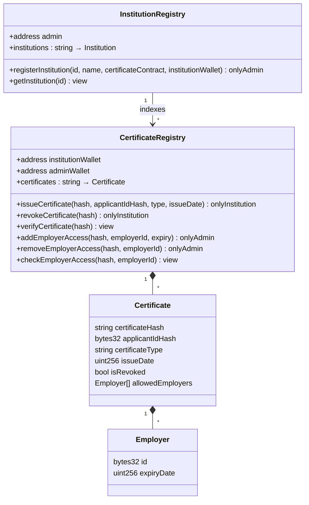

| Contract | Instances | Deployed by | Purpose |
|---|---|---|---|
| `InstitutionRegistry` | One per platform | Hardhat deploy script | Directory that maps an institution ID (for example `KSU-001`) to its certificate contract and wallet |
| `CertificateRegistry` | One per approved institution | Backend, automatically on admin approval | Holds that institution's certificates and their employer access lists |

**Two-wallet access control in `CertificateRegistry`**

| Operation | Signed by | Reason |
|---|---|---|
| `issueCertificate`, `revokeCertificate` | Institution wallet (MetaMask) | Only the institution can vouch for its own certificates; the platform cannot forge them |
| `addEmployerAccess`, `removeEmployerAccess` | Platform admin wallet (backend) | Applicants and employers need no wallet or ETH; the backend records the applicant's decision on chain |
| `verifyCertificate`, `checkEmployerAccess` | Anyone (read-only) | Verification is free and public |

Every write emits an event (`CertificateIssued`, `CertificateRevoked`, `EmployerAccessGranted`, `EmployerAccessRevoked`, `InstitutionRegistered`) for an on-chain audit trail. Revocation is permanent, and `checkEmployerAccess` returns `false` for revoked certificates, so revocation immediately cancels every employer grant.

---

## 6. Data Architecture

### 6.1 On-Chain vs Off-Chain Data

| Data | Database | Blockchain | Storacha |
|---|:---:|:---:|:---:|
| Certificate PDF file | — | — | ✔ (by CID) |
| SHA-256 file hash | ✔ | ✔ (record key) | — |
| Applicant national ID | ✔ (plain + hash) | ✔ (Keccak-256 hash only) | — |
| Certificate title, type, issue date | ✔ | type and date only | — |
| Revocation status | ✔ (`revoked_at`) | ✔ (`isRevoked`, source of truth) | — |
| Employer access grant and expiry | ✔ (`AccessShare`) | ✔ (`allowedEmployers`, source of truth) | — |
| Employer identity | ✔ | ✔ (Keccak-256 of official email) | — |
| Transaction hashes and block numbers | ✔ | — | — |
| User accounts, passwords, proof documents | ✔ | — | — |

**Principle:** the database is a fast index and holds user-facing metadata. The blockchain is the **source of truth** for authenticity, revocation, and access rights. Employer-facing views always re-check the contract before returning data.

### 6.2 Entity–Relationship Model

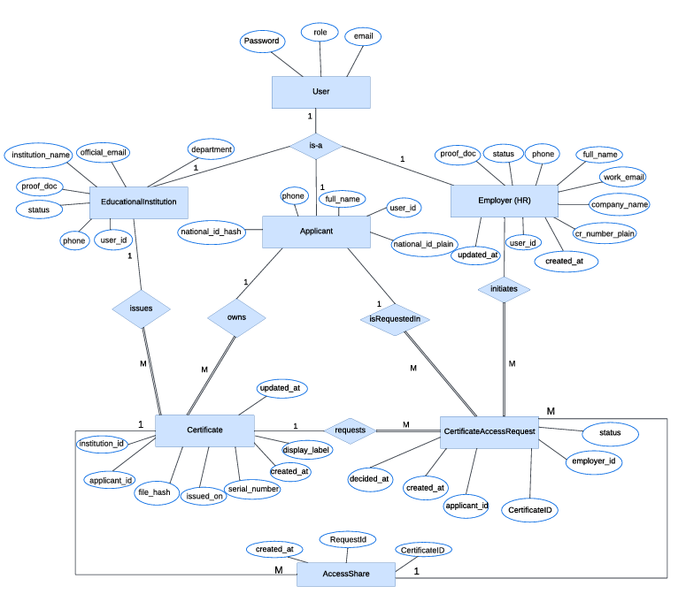

*Report Fig. 15 — Entity relationship diagram.*

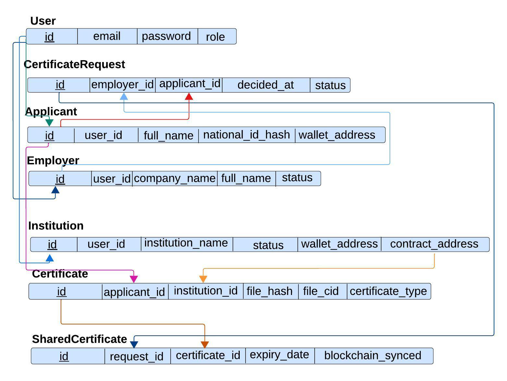

*Report Fig. 16 — Normalized relational schema. `CertificateRequest` and `SharedCertificate` are implemented as `AccessRequest` and `AccessShare`.*

**Integrity rules enforced in the database**

- `Certificate.file_hash` is globally unique, so the same PDF cannot be issued twice.
- At most one `PENDING` access request may exist per employer–applicant pair.
- An `AccessShare` must reference a certificate that belongs to the request's applicant.
- `AccessShare.is_active()` is true only when the share is synced to the blockchain, not revoked, and not expired.

### 6.3 Hashing Scheme

| Value | Algorithm | Computed by | Used as |
|---|---|---|---|
| Certificate fingerprint | SHA-256 of PDF bytes | Backend (`prepare`) | `certificateHash` key on chain; unique key in the database |
| Applicant ID hash | Keccak-256 of national ID | Backend | `applicantIdHash` on chain |
| Employer ID hash | Keccak-256 of employer official email | Backend | `Employer.id` in the access list |

Hashes are computed once by the backend and passed to the frontend, so the frontend (ethers.js) and backend (Web3.py) always use identical values. This fixed a hash-mismatch issue found during development.

---

## 7. Key Workflows

### 7.1 System Overview

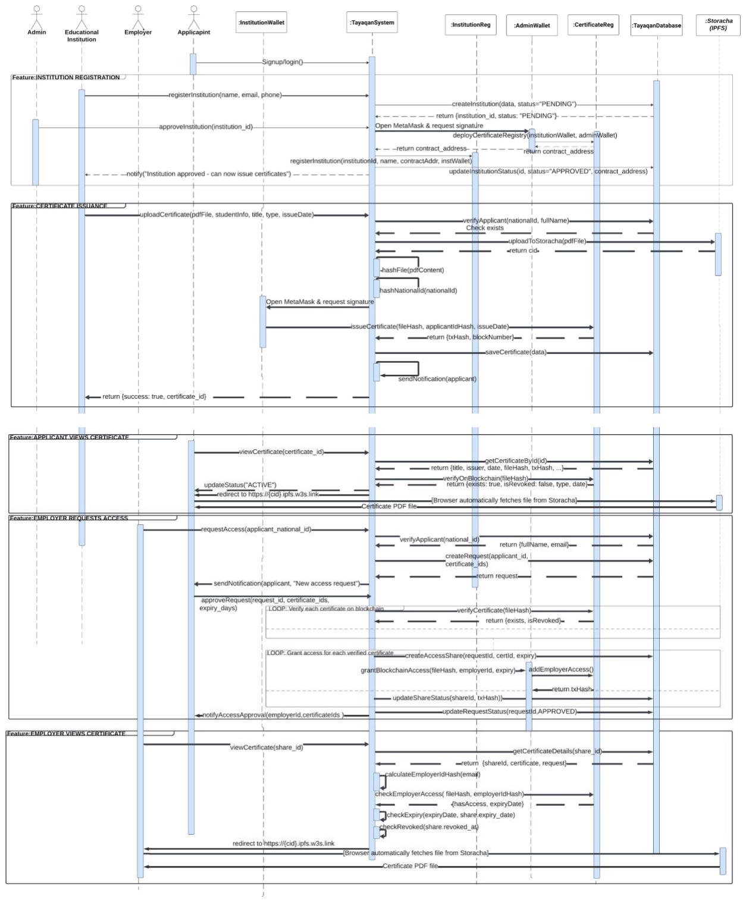

*Report Fig. 6 — High-level sequence diagram covering institution registration, certificate issuance, applicant viewing, employer access requests, and employer viewing.*

### 7.2 Registration and Login

| Institution | Employer | Applicant |
|---|---|---|
| 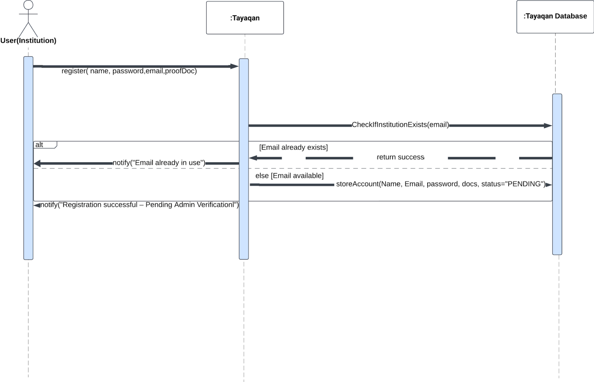 | 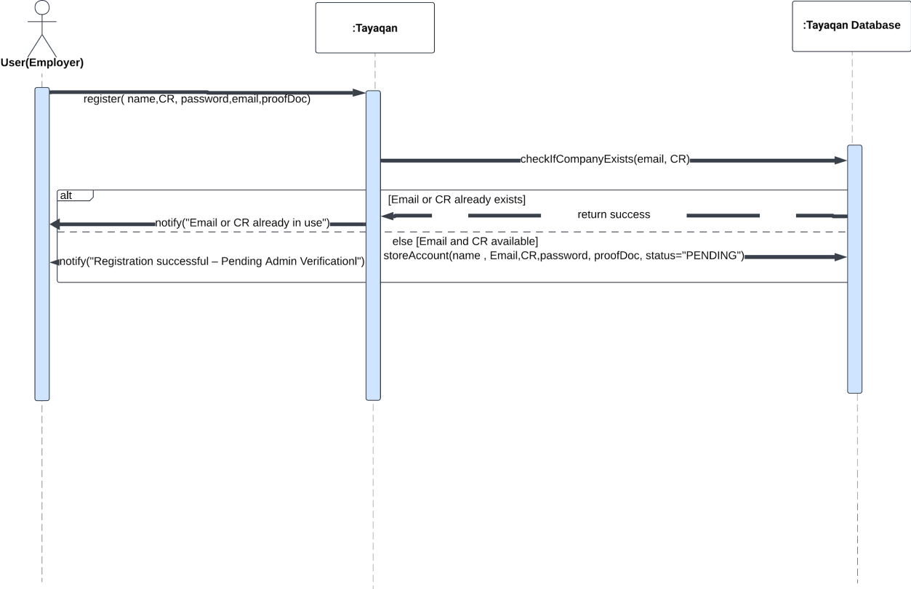 | 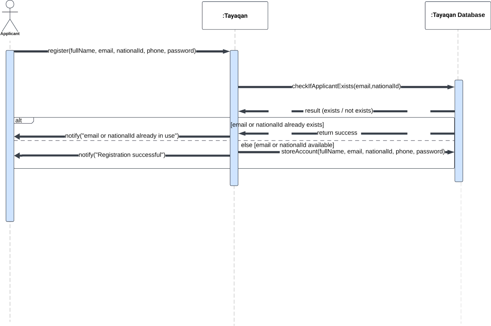 |

*Report Figs. 7–9 — Role-specific registration.*

- Applicants are active immediately after signup.
- Employers and institutions stay `PENDING` until an admin reviews their proof document.
- Login accepts either an email or a national ID and returns a JWT access and refresh token pair (Report Fig. 10).

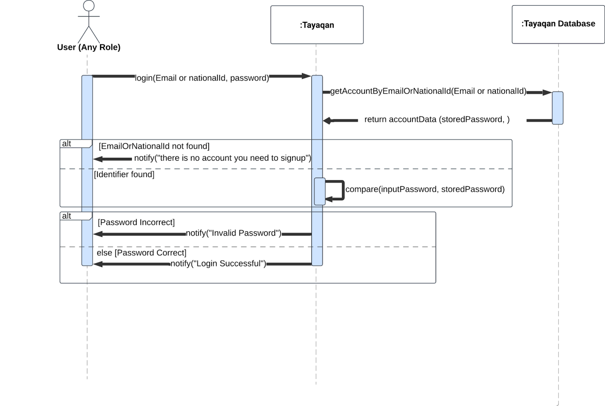

*Report Fig. 10 — Login.*

### 7.3 Institution Onboarding (Admin Approval)

When an admin sets an institution to `APPROVED`, the `institution_approved` event triggers automatic on-chain setup:

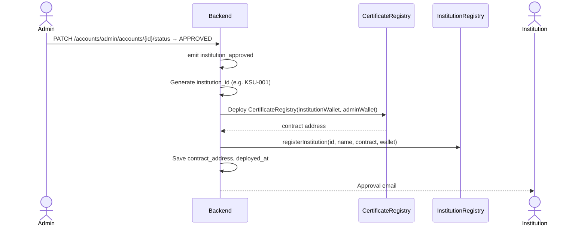

If deployment or registration fails, the institution goes back to `PENDING` so the approval can be retried. The database never points to a contract that was not deployed.

### 7.4 Certificate Issuance (Two-Phase Commit)

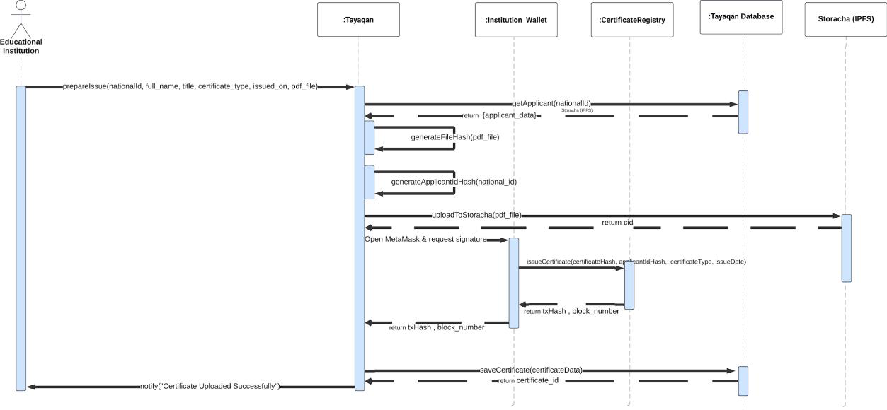

*Report Fig. 11 — Certificate issuance.*

1. **Prepare.** `POST /certificates/institution/prepare`. The backend checks that the applicant exists and the name matches, computes the SHA-256 file hash and the Keccak-256 applicant ID hash, uploads the PDF to Storacha, and returns the hashes and CID.
2. **Sign.** The frontend calls `issueCertificate(fileHash, applicantIdHash, type, issueDate)` through MetaMask with the institution's wallet.
3. **Confirm.** `POST /certificates/institution/confirm` with the transaction hash and block number. The backend creates the `Certificate` record and emits `certificate_issued`, which emails the applicant.

### 7.5 Access Request and Approval

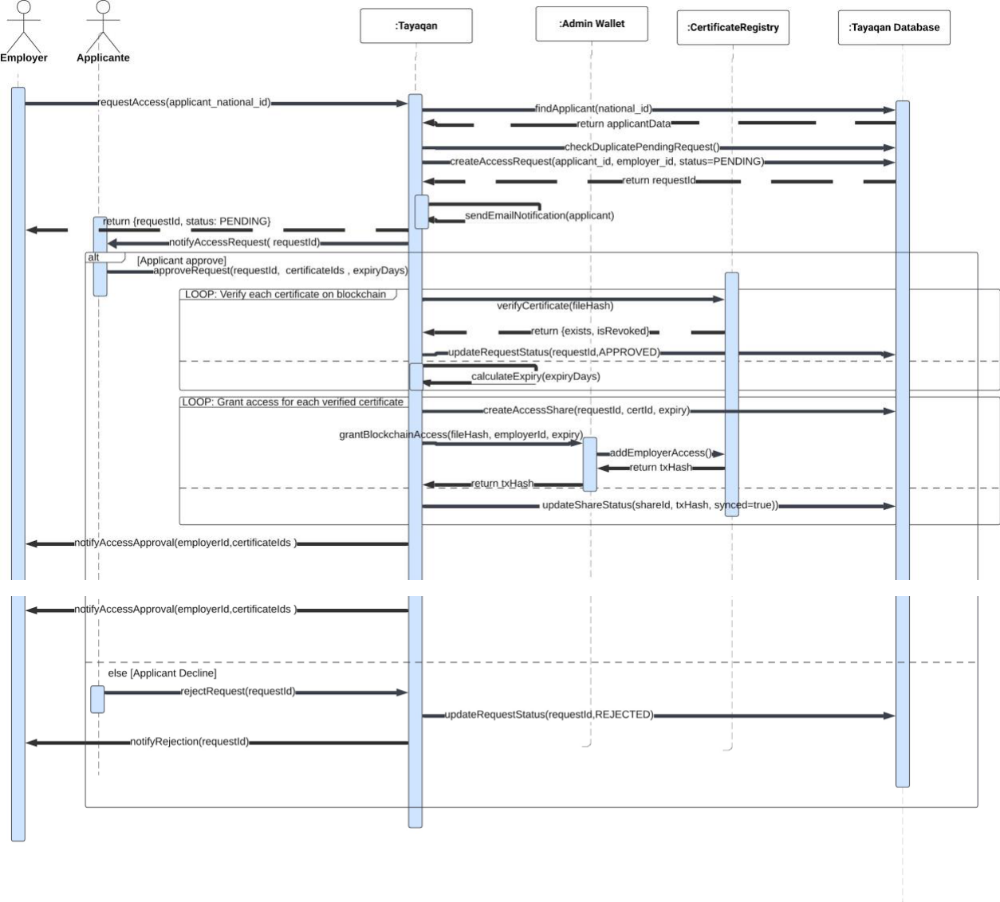

*Report Fig. 12 — Access request, approval, and rejection.*

- The employer looks up the applicant by national ID and creates a request. A duplicate `PENDING` request is rejected, and the applicant is emailed.
- On approval, the applicant selects certificates and an access duration (1, 3, 6, or 12 months, or no expiry).
- The backend verifies each selected certificate on chain, skips any that are missing, and creates an `AccessShare` for each one that passes.
- For each share, the backend calls `addEmployerAccess` with the admin wallet and marks the share `blockchain_synced` when the transaction succeeds.
- The applicant can later call `revoke_access`, which calls `removeEmployerAccess` on chain.

### 7.6 Viewing Certificates

| Employer view | Applicant view |
|---|---|
| 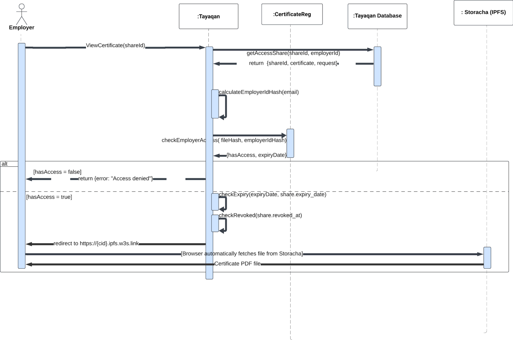 | 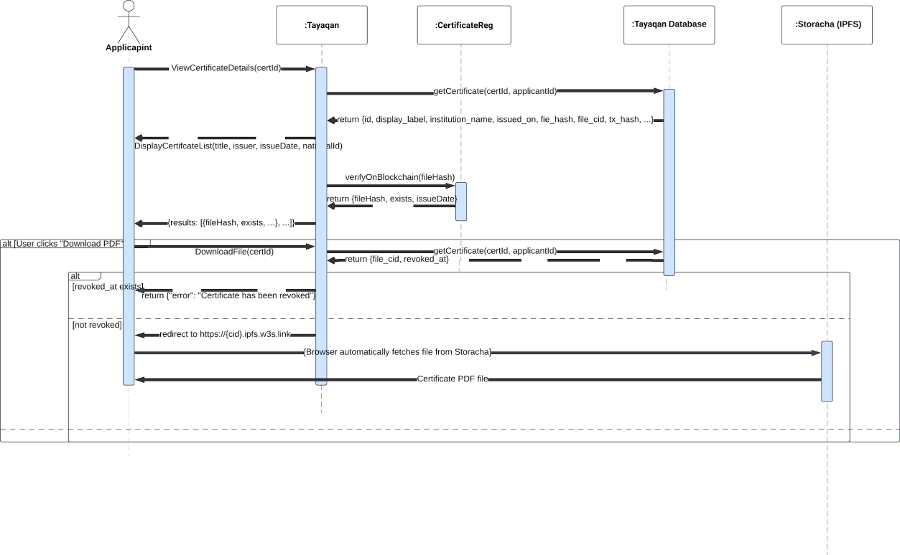 |

*Report Figs. 13–14.*

- **Employer.** Every view and download calls `checkEmployerAccess(fileHash, employerIdHash)`. If access is missing, expired, or the certificate is revoked, the API returns `403`. Otherwise the backend redirects to the Storacha gateway (`https://{cid}.ipfs.w3s.link`).
- **Applicant.** Certificates are listed from the database and verified on chain with `verify-batch`. Downloads of revoked certificates are refused.

### 7.7 Certificate Revocation

1. The institution selects a certificate on **Issued Certificates**.
2. The frontend calls `revokeCertificate(fileHash)` through MetaMask.
3. The frontend sends `POST /certificates/institution/{id}/revoke` with the transaction hash.
4. The backend records `revoked_at`, `revoke_tx_hash`, and `revoke_block_number`. Downloads are then refused, and all employer grants become invalid on chain.

---

## 8. Security Architecture

### 8.1 Authentication

- Stateless **JWT** authentication with Simple JWT; email (or national ID for applicants) is the login identifier.
- Access token lifetime 60 minutes (`JWT_ACCESS_MIN`); refresh token lifetime 7 days (`JWT_REFRESH_DAYS`).
- Refresh tokens are rotated on use and blacklisted after rotation.
- The frontend refreshes an expired access token automatically, sharing one in-flight refresh across concurrent requests.
- Password reset uses an emailed, single-use token link.

### 8.2 Authorization

| Level | Mechanism |
|---|---|
| **API default** | `IsAuthenticated` is the global DRF default; only login, signup, refresh, and password reset are public |
| **Role and status** | `IsInstitutionUser`, `IsApplicantUser`, `HasRole`, `IsEmployerApproved`, `IsInstitutionApproved`, and Django's `IsAdminUser` |
| **Object ownership** | Querysets are scoped to the requesting user: an institution sees its own certificates, an applicant their own, an employer only shares granted to it |
| **Smart contract** | `onlyInstitution` and `onlyAdmin` modifiers block unauthorized writes even if the backend is bypassed |

The full role matrix is in [System-Roles.md](System-Roles.md).

### 8.3 Key and Wallet Custody

| Key | Held by | Can do |
|---|---|---|
| Institution private key | The institution, in MetaMask | Issue and revoke that institution's certificates |
| Admin private key | Backend environment (`ADMIN_PRIVATE_KEY`) | Deploy and register contracts; grant and remove employer access |
| Storacha delegation proof | Backend environment (`STORACHA_PROOF`) | Upload files to the platform's Storacha space |

Because issuance requires the institution's own key, a compromise of the backend cannot forge or revoke certificates.

### 8.4 Data Protection

- Personal identifiers are hashed before they are written on chain, where data is public and permanent.
- Certificate files are not linked publicly. Download endpoints check ownership or an active on-chain grant before redirecting to the gateway.
- Uploaded certificates are validated as PDF files.
- CORS is restricted to the configured frontend origins.
- Secrets are loaded from `backend/.env`, which must never be committed.

### 8.5 Threat Summary

| Threat | Mitigation |
|---|---|
| Forged or altered PDF | Hash mismatch with the on-chain record (tested: a one-character change fails verification) |
| Fake institution | Admin reviews proof documents before a contract is deployed |
| Platform issuing fake certificates | Issuance requires the institution's own wallet signature |
| Wrong wallet used by an institution | Frontend blocks submission when MetaMask does not match the registered wallet; contract rejects any other sender |
| Employer accessing unshared certificates | Database scoping plus on-chain `checkEmployerAccess` |
| Continued use of a revoked certificate | On-chain `isRevoked` is checked on every employer view |
| Stolen access token | Short-lived access tokens with refresh rotation and blacklisting |
| Duplicate issuance | Unique `file_hash` in the database and a `Certificate already exists` check in the contract |

---

## 9. Deployment Architecture

### 9.1 Local Development

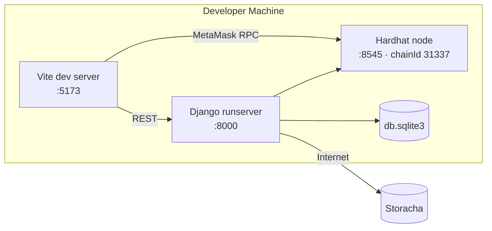

Start-up order:

1. `npx hardhat node` — local blockchain.
2. `npx hardhat deploy --network localhost` — deploys `InstitutionRegistry` and writes the deployment artifact that the backend reads.
3. `python manage.py migrate && python manage.py runserver` — backend API.
4. `npm run dev` — frontend.

Full instructions are in the root [README.md](../README.md).

### 9.2 Public Test Network

The Hardhat configuration includes **Ethereum Sepolia** (chain ID 11155111), which was also used for the performance tests. To deploy there, set `SEPOLIA_RPC_URL` and `PRIVATE_KEY` for Hardhat, then point the backend's `WEB3_RPC_URL`, `CHAIN_ID`, and `INSTITUTION_REGISTRY_ADDRESS` at Sepolia. Transaction links in the UI use the Sepolia Etherscan explorer.

### 9.3 Recommended Production Topology

| Concern | Recommendation |
|---|---|
| Frontend | `npm run build`; serve static files from a CDN or Nginx |
| Backend | Gunicorn behind Nginx with HTTPS; `DEBUG=false`; production `ALLOWED_HOSTS` and CORS origins |
| Database | PostgreSQL instead of SQLite |
| Media | Object storage (for example S3) for registration proof documents |
| Blockchain | Managed RPC provider; admin key in a secrets manager or KMS; consider a Layer 2 network to cut gas costs |
| Background work | A task queue (for example Celery with Redis) for contract deployment, access grants, and email |

---

## 10. Configuration

### 10.1 Backend (`backend/.env`)

| Variable | Purpose | Default |
|---|---|---|
| `DJANGO_SECRET_KEY` | Django signing key | development placeholder |
| `DEBUG` | Debug mode | `true` |
| `JWT_ACCESS_MIN` / `JWT_REFRESH_DAYS` | Token lifetimes | `60` / `7` |
| `WEB3_RPC_URL` | Ethereum JSON-RPC endpoint | `http://127.0.0.1:8545` |
| `CHAIN_ID` | Target chain ID | `31337` |
| `ADMIN_PRIVATE_KEY` | Platform admin wallet key | — |
| `INSTITUTION_REGISTRY_ADDRESS` | Deployed `InstitutionRegistry` address | — |
| `STORACHA_SPACE_DID` / `STORACHA_PROOF` | Storacha space and delegation proof | — |
| `EMAIL_HOST`, `EMAIL_PORT`, `EMAIL_USE_TLS`, `EMAIL_HOST_USER`, `EMAIL_HOST_PASSWORD`, `DEFAULT_FROM_EMAIL` | SMTP settings | Gmail SMTP on port 587 |

### 10.2 Frontend (`frontend/.env`)

| Variable | Purpose |
|---|---|
| `VITE_API_BASE_URL` | Backend API base URL (for example `http://127.0.0.1:8000/api`) |

### 10.3 Contracts (`Contract/.env`)

| Variable | Purpose |
|---|---|
| `SEPOLIA_RPC_URL` | Sepolia RPC endpoint |
| `PRIVATE_KEY` | Deployer key for Sepolia |
| `CMC_KEY` | CoinMarketCap key for USD gas reporting |

---

## 11. Quality Evidence

Results below are from Chapter VI of the Final Report.

### 11.1 Functional Testing

| Level | Tooling | Scope | Result |
|---|---|---|---|
| Backend unit | Django `TestCase` / pytest | Validators, hashing utilities, models, permissions, access-request state machine | All passed |
| Contract unit | Hardhat, Mocha/Chai | `CertificateRegistry` (34 tests, including tamper detection) and `InstitutionRegistry` (5 tests) | All passed |
| Backend integration | DRF `APIClient` | Signup, login, admin approval, issuance, management, revocation, verification, access flows, permissions | All passed |
| Contract integration | Hardhat | Full workflow (register → issue → verify → grant → check) and revocation invalidating access | All passed |
| System | Manual scenarios per role | Admin, Institution, Employer, and Applicant end-to-end flows | All passed |

```bash
cd Contract && npx hardhat test          # contracts
cd backend && pytest --cov               # backend
cd frontend && npm run typecheck && npm run lint
```

### 11.2 Smart Contract Cost and Latency

Measured on Sepolia; USD costs use 30 gwei mainnet gas prices and the ETH price at test time, so they vary with the market.

| Operation | Gas | Cost (USD) | Latency |
|---|---:|---:|---:|
| Deploy `InstitutionRegistry` (once) | 832,998 | $72.75 | 6.8 s |
| Deploy `CertificateRegistry` (per institution) | 1,643,801 | $143.56 | 12.3 s |
| Issue certificate | 122,285 | $10.68 | ≈11.9 s |
| Revoke certificate | 51,650 | $4.51 | ≈11.9 s |
| Add employer access | 100,147 | $8.75 | ≈12.5 s |
| Remove employer access | 37,747 | $3.30 | ≈13.7 s |
| Verify certificate (read) | 0 | Free | 104 ms |
| Check employer access (read) | 0 | Free | 102 ms |

| Gas per operation | Latency per operation |
|---|---|
| 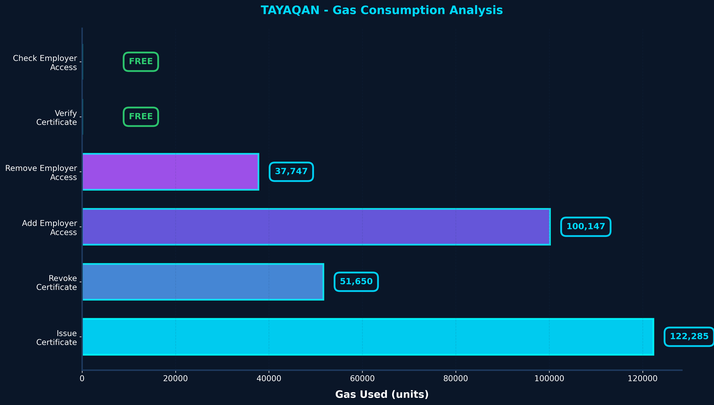 | 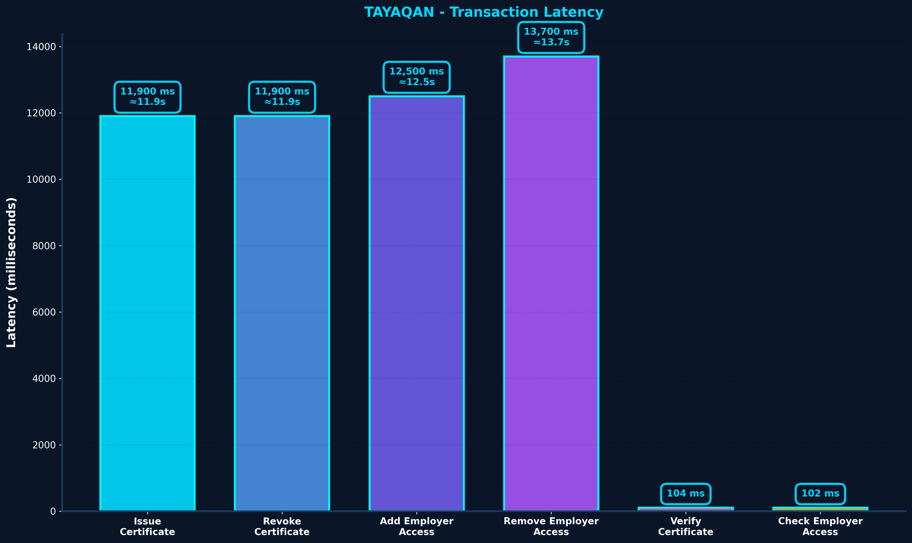 |

| Transaction cost | Deployment cost |
|---|---|
| 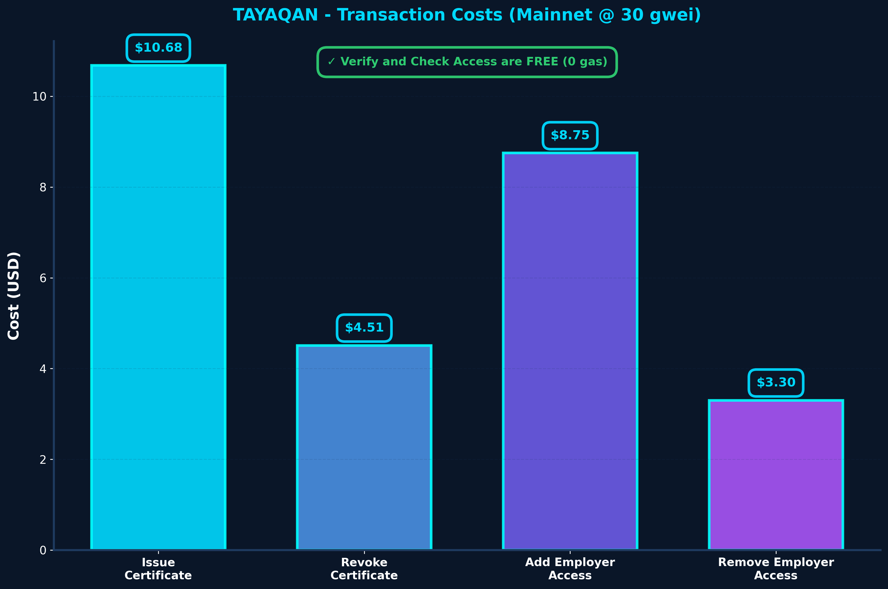 | 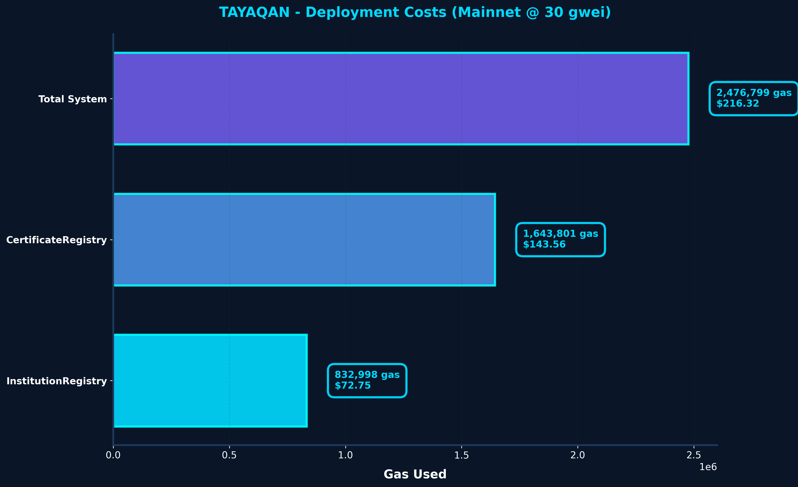 |

Write latency is dominated by Ethereum block time (≈12 s). Verification, the most frequent operation, is free and returns in about 100 ms.

### 11.3 Scalability

Issuing 100 certificates in sequence on Sepolia used 12,219,752 gas in total: an average of **122,197 gas** and **12.2 s** per certificate. Gas per issuance stays constant as the number of certificates grows, which confirms the O(1) mapping-based storage design.

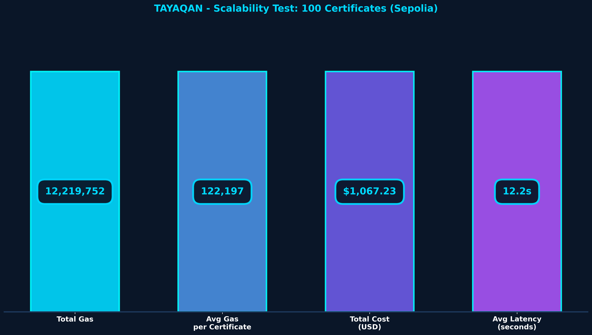

### 11.4 Usability

A usability survey with institution administrators, employers, and job seekers gave an overall rating of **4.78 / 5**, with no negative responses on any question (institutions 4.67, job seekers 5.00, employers 4.67).

---

## 12. Architectural Decisions

| # | Decision | Rationale | Trade-off |
|---|---|---|---|
| AD-1 | Store only hashes on chain; files on Storacha | Minimizes gas and keeps personal documents off a public ledger | Depends on Storacha availability for file retrieval |
| AD-2 | One `CertificateRegistry` per institution, indexed by `InstitutionRegistry` | Isolates each institution's authority and data; clear ownership | ≈1.6M gas one-time deployment per institution |
| AD-3 | Institutions sign issuance and revocation in MetaMask | The platform cannot forge certificates; strongest trust guarantee | Institutions must manage a wallet and pay gas |
| AD-4 | Backend admin wallet manages employer access | Applicants and employers need no wallet or crypto knowledge | The admin key is a privileged secret on the server |
| AD-5 | Two-phase issuance (`prepare` → sign → `confirm`) | Backend computes hashes and uploads the file; the user signs only the final transaction | A failure between signing and `confirm` can leave an on-chain record with no database row |
| AD-6 | Blockchain is the source of truth for revocation and access | A tampered database cannot grant access | Every employer view needs an RPC call (≈100 ms) |
| AD-7 | In-process observer pattern for side effects | Decouples views from email and deployment without extra infrastructure | Handlers run synchronously within the request |
| AD-8 | Stateless JWT authentication | Fits a single-page app on a separate origin | Revocation relies on short lifetimes and the blacklist |
| AD-9 | Ethereum (public chain) rather than a private ledger | Public, independent verifiability; mature tooling (Hardhat, ethers.js, Web3.py) | Gas cost per write (≈$10.68 per certificate at 30 gwei) |

---

## 13. Known Limitations and Future Work

### 13.1 Current Limitations

- **Transaction costs.** Issuing on Ethereum mainnet would cost about $10.68 per certificate at 30 gwei.
- **English-only interface.** Arabic is not yet supported.
- **MetaMask dependency.** Institutions need a browser that supports the MetaMask extension.
- **Synchronous blockchain calls.** Contract deployment and `addEmployerAccess` wait for receipts inside the HTTP request (up to 120 s each).
- **No reconciliation job.** If the browser closes after the on-chain transaction but before `confirm`, the database misses the certificate. `AccessShare` records with `blockchain_synced = false` are not retried automatically.
- **Single admin key.** Employer access management depends on one hot wallet on the server.
- **Linear access lists.** `addEmployerAccess` and `checkEmployerAccess` loop over the employer array, so cost grows with the number of employers per certificate.
- **Employer identity hash.** The on-chain employer ID is derived from the official email, so changing that email detaches existing grants.
- **Plain national ID in the database.** Kept for lookup; it should be encrypted at rest in production.
- **Artifact path coupling.** The backend loads ABIs from a hard-coded `contract/` path that must match the Hardhat folder name on case-sensitive file systems.
- **Development defaults.** SQLite, `DEBUG=true`, and localhost-only hosts and CORS origins.

### 13.2 Roadmap

| Priority | Improvement |
|---|---|
| High | Deploy on a Layer 2 network (for example Polygon) or a permissioned ledger (Hyperledger Fabric) to cut transaction costs |
| High | Arabic and English interface (i18next is already a dependency) |
| High | Move blockchain writes and email to a background task queue with retries |
| High | Reconciliation job that indexes contract events and repairs mismatches between the database and the chain |
| Medium | Store the admin key in a KMS or HSM, or replace it with a multisig |
| Medium | Replace the employer array with a `mapping(bytes32 => uint256)` for constant-time access checks |
| Medium | Optional wallet mode so advanced applicants can hold their own credentials |
| Medium | Public verification page: upload a PDF and check its hash against the chain without logging in |
| Low | Progressive web app for wider browser and device support |
| Low | QR code on each certificate linking to its verification page; W3C Verifiable Credentials support |

---

## 14. Glossary

| Term | Definition |
|---|---|
| **ABI** | Application Binary Interface; the JSON description used to call a smart contract |
| **CID** | Content Identifier; the hash-based address of a file in IPFS/Storacha |
| **DRF** | Django REST Framework |
| **EIP-1559** | Ethereum fee mechanism using a base fee plus a priority tip |
| **Gas** | The unit that measures the computational cost of an Ethereum transaction |
| **Hardhat** | Ethereum development environment for compiling, testing, and deploying contracts |
| **JWT** | JSON Web Token; a signed token used for stateless authentication |
| **Keccak-256** | The hash function used natively by Ethereum |
| **MetaMask** | Browser wallet extension used to sign Ethereum transactions |
| **SHA-256** | Cryptographic hash function used to fingerprint certificate PDFs |
| **Sepolia** | Ethereum public test network |
| **Storacha** | Decentralized storage service built on IPFS and Filecoin |
| **Web3.py** | Python library for interacting with Ethereum |
